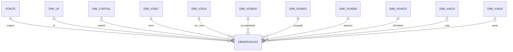

# Empreendedorismo Feminino - Bahia e Salvador

Documentação do Marco 2, revisada em 20/10/2026. Esta versão foi preparada em uma cópia separada, sem alterar o repositório Git. As evidências de carga no Aiven são de 14/10/2026; a importação da infraestrutura pelo Terraform ainda não foi executada.

## Dados utilizados

### Fonte dos dados

A fonte é a Pesquisa Nacional por Amostra de Domicílios Contínua trimestral (PNADC), do IBGE, conforme a documentação fornecida. Foram utilizados os arquivos locais originais e os metadados da pasta `Projeto_Empreendedorismo_Feminino`, sem modificar os originais.

### Identificação da base

- Microdados originais: `PNADC_012026.txt` e `PNADC_022026.txt`.
- Layout posicional: `input_PNADC_trimestral.txt`.
- Dicionários: `dicionario_PNADC_microdados_trimestral.xls` e `Variaveis_PNADC_Trimestral.xls`.
- Base tratada: `dados/pnadc_ocupados_2026.parquet` e `dados/pnadc_ocupados_2026.csv`.
- Versão dos dados: `fase2-bahia-v1`.
- Proveniência e hashes: `dados/auditoria.json` e `dados/fontes.csv`.

### Período e recorte utilizado

São mantidas pessoas ocupadas (`VD4002=1`) do 1º e do 2º trimestres de 2026, exclusivamente da Bahia (`UF=29`). Salvador é identificado por `UF=29 AND Capital=29` e está incluído no total estadual. Ambos os sexos e todas as posições na ocupação permanecem para comparação.

| Período | Bahia, incluindo Salvador | Salvador, subconjunto |
|---|---:|---:|
| 1º trimestre de 2026 | 10.062 | 1.645 |
| 2º trimestre de 2026 | 10.644 | 1.737 |
| Total de observações | 20.706 | 3.382 |

### Características relevantes da base

Os TXT são de largura fixa, com 3.478 caracteres por linha, sem a quebra de linha. Cada registro tratado representa uma observação de pessoa por trimestre e contém 21 campos de origem, 5 indicadores e 2 campos de rastreabilidade.

Pessoas podem reaparecer em trimestres diferentes; as 20.706 observações não representam necessariamente pessoas distintas. Salvador já integra a Bahia, portanto os dois recortes não devem ser somados. Rendas são habituais do trabalho principal e nominais. O peso calibrado, a UPA e o estrato são preservados. Estudos complementares não foram unidos aos microdados como resultados trimestrais.

## Tratamento realizado

### Principais problemas ou características identificados

A origem não possui separadores: sua leitura depende das posições definidas no layout. Os campos apresentam códigos categóricos, identificadores com zeros iniciais, valores opcionais em branco e pesos com oito casas decimais. Também foi necessário reduzir o volume nacional para o recorte da Bahia e verificar a unicidade das observações.

Foram lidas 1.032.879 linhas originais. O filtro de ocupação excluiu 568.422 registros fora do universo de ocupados. Entre os 464.457 ocupados, o filtro geográfico excluiu 443.751 de outras UFs, resultando em 20.706 observações da Bahia. Exclusões por universo e geografia não são erros de dados. Não foram encontrados registros inválidos, duplicatas ou conflitos na execução registrada.

### Decisões, transformações e justificativas

| Decisão | Transformação realizada | Justificativa |
|---|---|---|
| Leitura pelo layout | Extração dos 21 campos em suas posições e conferência com os dicionários | Interpretar corretamente o TXT posicional |
| Universo de análise | Manter `VD4002=1` e `UF=29` | Analisar ocupados da Bahia, incluindo Salvador |
| Controle de memória | Leitura em fluxo, deduplicação em SQLite e exportação em blocos de 25.000 | Evitar carregar os 3,59 GB de TXT em memória |
| Identificadores textuais | Preservar UPA, estrato, domicílio, painel, entrevista e ordem como texto | Conservar zeros à esquerda |
| Precisão numérica | Converter peso e renda com `Decimal` e armazenar em `NUMERIC` | Evitar arredondamento intermediário por ponto flutuante |
| Valores ausentes | Converter brancos opcionais para `NULL`; manter zeros informados | Distinguir ausência de renda de renda zero |
| Códigos válidos | Conferir domínios e preservar códigos de ignorado previstos | Manter a interpretação do IBGE |
| Duplicatas | Remover repetições idênticas; separar todas as ocorrências de chaves com conteúdo divergente | Evitar contagem repetida e perda silenciosa de informação |
| Rastreabilidade | Guardar SHA-256 da fonte e linha original | Identificar a versão utilizada e localizar a origem de cada observação |
| Arquivos de saída | Gerar Parquet tipado/compactado e CSV para inspeção e carga | Facilitar reprodução e armazenamento no PostgreSQL |

Não houve imputação, subamostragem, agregação anterior à carga ou exclusão de rendas altas válidas. SQLite é apenas uma área temporária; o banco de disponibilização é PostgreSQL.

Os indicadores identificam Bahia, Salvador, empreendedores (`VD4009 IN (8,9)`), empreendedoras (essa condição e `V2007=2`) e registro do negócio no CNPJ. A formalização é aplicada somente a empreendedores; fora desse universo ou sem resposta, fica `NULL`.

Os procedimentos estão em `scripts/etl.py`. Erros e conflitos são registrados em `dados/rejeitados.csv`; a versão tratada e as contagens constam de `dados/auditoria.json`. A comparação integral com o recorte da versão nacional anterior está em `evidencias/comparacao_recorte.json`. Justificativas adicionais estão em `docs/DECISOES_TECNICAS.md`.

## Modelagem

### Estrutura do banco

O banco na nuvem é `defaultdb`, no Aiven, e as tabelas do projeto estão no esquema `ef`.

| Entidade | Finalidade |
|---|---|
| `ef.observacao` | 20.706 observações no grão pessoa-trimestre, com os campos analíticos e de origem |
| `ef.fonte` | Identificação das 2 fontes originais, incluindo arquivo, hash, tamanho e período |
| `ef.dim_uf` e `ef.dim_capital` | Referências geográficas; nesta versão, somente o código 29 |
| `ef.dim_v2007` e `ef.dim_v2010` | Sexo e cor/raça |
| `ef.dim_vd3004` e `ef.dim_vd4002` | Escolaridade e condição de ocupação |
| `ef.dim_vd4009` e `ef.dim_vd4010` | Posição na ocupação e grupamento de atividade |
| `ef.dim_v4019` e `ef.dim_v4018` | Registro no CNPJ e faixa de pessoas no negócio |

São dez dimensões e 47 códigos de referência. Cada dimensão contém `codigo SMALLINT PRIMARY KEY` e `rotulo TEXT NOT NULL`. O inventário completo de tabelas, campos, tipos, restrições e quantidades está em `evidencias/estrutura_nuvem.json`.

### Estratégia de organização dos dados

Foi adotado um modelo relacional que preserva o detalhe pessoa-trimestre e separa os rótulos em tabelas de referência. Isso reduz repetição textual, facilita consultas e permite validar os códigos por chaves estrangeiras.

A chave primária de `observacao` é `(ano,trimestre,upa,v1008,v1014,v1016,v2003)`. Há também unicidade por `(arquivo_sha256,linha_origem)`. A fonte é referenciada pelo hash e as dimensões por seus códigos. Restrições validam ocupação, idade, peso, geografia e indicadores; `CHECK (uf=29)` impede armazenar outras UFs. Índices apoiam consultas por período, geografia, sexo e empreendedoras.

Os identificadores usam `VARCHAR`, os códigos usam `SMALLINT`, o peso usa `NUMERIC(18,8)`, a renda usa `NUMERIC(12,2)`, os indicadores usam `BOOLEAN`, o hash usa `CHAR(64)` e a linha original usa `BIGINT`. O dicionário detalhado está em `dados/dicionario_tratado.json`.

As views `ef.v_recortes`, `ef.v_resumo_geografico` e `ef.v_perfil_empreendedores` oferecem os recortes Bahia e Salvador. Totais estimados usam a soma dos pesos; médias de renda usam soma de peso vezes renda dividida pela soma dos pesos apenas das observações com renda informada. Não há resumo Brasil calculado a partir do recorte estadual. Erros padrão e intervalos de confiança exigem tratamento adicional do desenho amostral.

### Representação da modelagem utilizada



O diagrama com os 28 campos está em `docs/modelagem.mmd`. As cardinalidades opcionais refletem os campos que aceitam `NULL`. O SQL executável está em `sql/01_estrutura.sql`, `sql/02_views.sql` e `sql/04_recorte_bahia.sql`.

## Infraestrutura

### Serviços utilizados

O armazenamento é realizado no PostgreSQL gerenciado do Aiven. A carga e a conexão TLS 1.3 foram verificadas em 14/10/2026. A cópia local `big_data` é utilizada para desenvolvimento e validação.

| Parâmetro Aiven | Valor |
|---|---|
| Host | `pg-3746e955-bigdatalkb.f.aivencloud.com` |
| Porta | `22835` |
| Banco | `defaultdb` |
| Usuário | `avnadmin` |
| Esquema do projeto | `ef` |
| SSL | `require` |

Os parâmetros públicos estão em `config/postgres.aiven.json`; a configuração local está em `config/postgres.local.json`. Nenhuma senha é armazenada nesses arquivos.

### Recursos provisionados e infraestrutura como código

O serviço Aiven já existente contém 12 tabelas do projeto: fonte, observação e dez dimensões, além de índices, restrições e três views. Os recursos internos do produto, como nós, armazenamento e mecanismos de backup, são gerenciados pelo Aiven. Não foram declaradas VMs, redes ou buckets próprios que não existem no projeto.

Os arquivos em `infra/aiven/` representam o serviço existente pelo recurso `aiven_pg.projeto`. Projeto, nome do serviço, cloud/região e plano são entradas obrigatórias que devem ser confirmadas no painel. Não foram inferidos pelo hostname.

**Situação do Terraform:** os arquivos passaram em `fmt` e `validate`, mas a importação do serviço, o plano autenticado e qualquer `apply` ainda não foram executados. Portanto, esta revisão não declara a infraestrutura como provisionada ou adotada pelo Terraform. O token de API e os quatro parâmetros reais continuam pendentes, conforme registrado em `evidencias/terraform_validacao.json`.

### Tecnologias empregadas e segurança

São utilizados Python, SQLite temporário, Parquet, CSV, PostgreSQL, Aiven e Terraform com o provedor `aiven/aiven` 4.62.0. O lock fixa os checksums do provedor; `prevent_destroy` protege o recurso contra destruições/substituições planejadas enquanto estiver na configuração.

A senha PostgreSQL chega por prompt e ambiente de processo. O token Terraform é separado da senha do banco e usa uma variável `sensitive` e `ephemeral`. Outputs não expõem senha ou URI autenticada. Mesmo assim, o estado pode conter credenciais retornadas pelo provedor; state, planos, chaves, logs de depuração e ambientes virtuais ficam fora do Git e do pacote.

O modo `require` comprova criptografia, mas não valida o hostname com um CA fornecido pela equipe. O carregador também permite `verify-full` com `sslrootcert` quando o CA estiver disponível. A estratégia completa está em `docs/SEGURANCA.md` e as instruções Terraform em `infra/aiven/README.md`.

## Execução

### Ferramentas e dependências necessárias

- Python 3.12 e `pip`.
- Bibliotecas de `requirements.txt`: `xlrd==2.0.2`, `pyarrow==26.0.0` e `psycopg[binary]==3.3.6`.
- PowerShell para os iniciadores de conexão e importação.
- Terraform >=1.10 e <2.0; os arquivos foram validados com Terraform 1.16.6 e provedor Aiven 4.62.0.
- Cliente PostgreSQL, como pgAdmin ou `psql`, para consultas; `pg_restore` compatível com PostgreSQL 18 para restaurar os backups incluídos.

### Informações necessárias para reprodução

Para reproduzir desde a origem, é necessária a pasta que contém `dados_brutos` e `documentação`, com os TXT, layout e dicionários. Para reproduzir a partir da base tratada, o Parquet e os metadados estão incluídos; o carregador reconstrói o CSV automaticamente quando necessário.

Para consultar ou carregar o Aiven, é necessária a senha PostgreSQL, informada por prompt ou `PGPASSWORD`. Para importar o serviço em Terraform, são necessários um token de API autorizado e os nomes reais de projeto/serviço, cloud/região e plano. Esses segredos não devem ser enviados ao Git ou inseridos nos exemplos.

A estrutura dos arquivos é:

```text
scripts/       # Tratamento, carga, exportação e verificadores
sql/           # Tabelas, chaves, restrições, índices e views
infra/aiven/   # Terraform, lock, exemplos e importação
config/        # Parâmetros de conexão sem senha
dados/         # Base tratada, catálogos, auditoria e backups
docs/          # Modelagem, segurança, decisões e relatórios
evidencias/    # Registros históricos e verificações desta revisão
tests/         # Testes do verificador de segredos
```

### Sequência geral de execução da solução

**1. Preparar o ambiente**, a partir da pasta da entrega:

```powershell
python -m venv .venv
& ./.venv/Scripts/python.exe -m pip install -r requirements.txt
```

**2. Gerar e validar a base tratada**, caso queira reproduzir desde os originais:

```powershell
& ./.venv/Scripts/python.exe scripts/etl.py --projeto "C:/Users/saeb/Downloads/Projeto_Empreendedorismo_Feminino" --saida dados --temporarios work
& ./.venv/Scripts/python.exe scripts/verificar_artefatos.py
```

Substitua apenas o caminho após `--projeto` pela pasta correta. O filtro `UF=29` já é aplicado automaticamente. O ETL substitui os arquivos tratados da pasta de saída; backups e relatórios não são regenerados por esse comando. Se utilizar o Parquet incluído, não é necessário reler os originais.

**3. Validar os arquivos Terraform**, sem operações na conta:

```powershell
terraform -chdir=infra/aiven init -backend=false
terraform -chdir=infra/aiven fmt -check -recursive
terraform -chdir=infra/aiven validate
```

Com token e parâmetros reais, importe o serviço existente e revise o plano:

```powershell
./infra/aiven/importar_existente.ps1 -Projeto "PROJETO_REAL" -Servico "SERVICO_REAL" -Cloud "CLOUD_REGIAO_REAL" -Plano "PLANO_ATUAL"
```

O iniciador solicita o token, importa o recurso e executa `plan`; não executa `apply`. Não crie outro serviço nem altere plano/região para simular uma evidência de provisionamento. As instruções e pendências estão em `infra/aiven/README.md`.

**4. Executar a carga**, somente se for necessário criar ou recarregar o destino:

```powershell
# Banco novo: omitir -Substituir.
./scripts/conectar_e_carregar_aiven.ps1

# Recarga intencional de tabelas ef já existentes:
./scripts/conectar_e_carregar_aiven.ps1 -Substituir
```

A substituição é transacional e limitada às tabelas do esquema `ef`. Sem `-Substituir`, o carregador recusa alterar tabelas já populadas. A opção explícita `--config` tem precedência sobre `PGCONNECTION`; sem essa opção, o ambiente pode fornecer a conexão e, se ausente, é usado o perfil local. Para o ambiente local, utilize `./scripts/conectar_e_carregar.ps1`.

**5. Conferir os dados e a segurança**. Com a senha em `PGPASSWORD`, a consulta abaixo gera as evidências de nuvem:

```powershell
& ./.venv/Scripts/python.exe scripts/verificar_postgres.py --config config/postgres.aiven.json --nuvem
& ./.venv/Scripts/python.exe scripts/verificar_segredos.py --raiz . --saida evidencias/seguranca_revisao.json
& ./.venv/Scripts/python.exe -m unittest discover -s tests -v
```

As consultas de conferência estão em `sql/03_validacao.sql`. Para consultar somente Salvador:

```sql
SELECT * FROM ef.observacao WHERE uf=29 AND capital=29;
```

**6. Revisar a documentação e as evidências antes de publicar**. `carga_nuvem.json`, `estrutura_nuvem.json`, `validacao_nuvem.txt` e `comparacao_integral_aiven.json` registram a carga histórica. `terraform_validacao.json`, `seguranca_revisao.json` e `repositorio_preservado.json` registram as verificações desta revisão. A inspeção de segredos é estática e não certifica binários ou histórico remoto.

O pacote inclui a base tratada, backups, código, SQL, infraestrutura e documentação. As decisões estão em `docs/DECISOES_TECNICAS.md` e o mapeamento da atividade em `docs/ITENS_DA_ENTREGA.md`. A publicação desta revisão no repositório continua suspensa, conforme a solicitação do usuário.