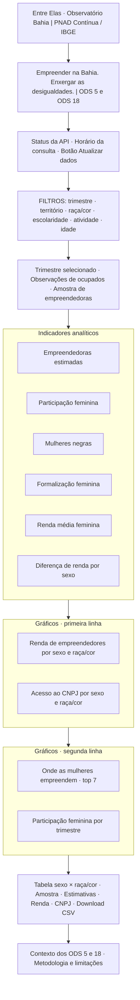

# Entre Elas · Bahia

Dashboard Plotly Dash com API REST própria para os dados da PNAD Contínua. Fluxo: **base tratada → API HTTP → dashboard**, mantendo os seis indicadores, filtros, gráficos interseccionais e exportação CSV.

## Acesso ao dashboard: execução local em um comando

Com as dependências instaladas, execute no PowerShell do VS Code, nesta pasta:

```powershell
.\.venv\Scripts\python.exe run.py
```

Abra **http://127.0.0.1:8050**. A API fica em **http://127.0.0.1:8000**. Ctrl+C encerra os dois serviços. Se necessário, crie o ambiente com `python -m venv .venv` antes de instalar as dependências.

**Preparação inicial, somente na primeira instalação:**

```powershell
python -m venv .venv
.\.venv\Scripts\python.exe -m pip install -r requirements.txt
```

O endereço acima é local e funciona enquanto `run.py` estiver ativo. Esta entrega usa a alternativa de execução local prevista no requisito; não há um link de hospedagem pública.

Se uma versão antiga estiver executando, encerre-a com Ctrl+C no terminal antes de iniciar `run.py`. O iniciador verifica se as portas estão ocupadas para evitar que você continue acessando uma instância antiga.

O projeto não exige banco, senha nem certificado de nuvem. As configurações ficam no `.env`; `.env.example` é o modelo. O dashboard consulta exclusivamente a API, sem leitura direta de arquivo nem troca automática de fonte em caso de erro.

O [guia de implantação e infraestrutura](docs/implantacao.md) detalha os pré-requisitos, a preparação automatizada, portas, configuração, atualização, diagnóstico e pipeline de validação. A preparação inicial também pode ser executada com `python scripts/preparar_ambiente.py`. A entrega usa infraestrutura local e não requer Terraform ou hospedagem adicional. Código, scripts e documentação acompanham esta entrega no repositório [yLu4n/big_data_entrega_3](https://github.com/yLu4n/big_data_entrega_3).

## Organização da entrega 3

A raiz contém a versão atual com API própria e dashboard. A base necessária à execução acompanha o projeto em `Dados_tratados/Entrega_Tecnica_Fase_2_Bahia.zip`. Nenhuma senha ou configuração `.env` local é necessária no clone: os padrões permitem iniciar a aplicação após preparar o ambiente.

Os materiais anteriores foram preservados em [historico/marco2](historico/marco2/README.md). Eles documentam outra etapa e não fazem parte da infraestrutura nem das instruções de execução atuais. As [decisões técnicas da entrega 3](docs/DECISOES_TECNICAS.md) descrevem a arquitetura implementada e distinguem melhorias futuras.

Para executar separadamente, use dois terminais:

```powershell
# Terminal 1
.\.venv\Scripts\python.exe api.py
# Terminal 2
.\.venv\Scripts\python.exe app.py
```

Nesse modo, `API_BASE_URL` define a API consultada. No modo conjunto, `run.py` usa a API local na porta `API_PORT`. Ambos os serviços escutam somente em `127.0.0.1`, para execução local.

## Diagrama da interface visual

O diagrama representa as seções reais da interface, de cima para baixo. É um esquema da tela, não uma captura; a quantidade de colunas se adapta à largura do dispositivo.



Os filtros atualizam os cartões, os cruzamentos e a exportação. O gráfico de evolução mantém os demais filtros e mostra todos os trimestres disponíveis separadamente. O gráfico de renda e a tabela consideram apenas empregadores e trabalhadores por conta própria.

## Atualização dos dados

A API **relê a fonte em cada requisição**. O dashboard busca novamente os dados ao mudar filtros, clicar em “Atualizar dados” e a cada `REFRESH_SECONDS` (padrão 60; mínimo 15 segundos). A resposta usa `Cache-Control: no-store`.

Por padrão, a fonte é o CSV dentro de `Dados_tratados/Entrega_Tecnica_Fase_2_Bahia.zip`. Para usar uma base atualizável, configure um CSV com o mesmo layout:

```dotenv
API_BASE_URL=http://127.0.0.1:8000
API_PORT=8000
API_TIMEOUT_SECONDS=15
DATA_FILE=Dados_tratados/base_atualizada.csv
REFRESH_SECONDS=60
PORT=8050
```

`DATA_FILE` vazio usa o ZIP. Caminhos relativos partem da pasta do projeto. Caminhos absolutos no Windows podem usar barras `/` e aspas. Reinicie os serviços após alterar o `.env`. Alterações no conteúdo da fonte já configurada aparecem na próxima consulta, sem reiniciar. Para atualizar o CSV durante o uso, grave um arquivo temporário e substitua o destino de forma atômica, evitando ler gravações incompletas.

**Tempo real significa consultar a versão atual da base. A API não coleta novas divulgações do IBGE automaticamente.** Novos dados precisam ser tratados e incorporados ao arquivo de origem. O campo `meta.consultado_em` indica a hora UTC da leitura, não a data da divulgação. `meta.versao` é o SHA-256 do CSV e muda quando seus bytes mudam.

## Contrato da API

O contrato autoritativo fica em `api/openapi.json`, também disponível por `GET /openapi.json`.

| Método / rota | Resultado |
| --- | --- |
| `GET /health` | HTTP 200 se o processo está ativo; não verifica a base |
| `GET /api/v1/observacoes` | HTTP 200 com `{data: [...], meta: {...}}` |
| `GET /openapi.json` | Documento OpenAPI 3.1 |

A rota de dados entrega o snapshot completo dos ocupados da Bahia, sem paginação, contendo somente 14 variáveis analíticas: `ano`, `trimestre`, `uf`, `capital`, `v1028`, `v2007`, `v2009`, `v2010`, `vd3004`, `vd4002`, `vd4009`, `v4019`, `vd4010` e `vd4016`. Identificadores domiciliares e de linha não são enviados. Ausências opcionais são `null`; a lista pode estar vazia. O volume inicial é de 20.706 observações. Os filtros pertencem ao servidor Python do dashboard e usam o mesmo snapshot para todos os gráficos de uma atualização.

Erros seguem `{error: {code, message}}`. Fonte ausente ou inválida retorna **503 SOURCE_UNAVAILABLE**; rota inexistente retorna **404 NOT_FOUND**; escrita retorna **405 METHOD_NOT_ALLOWED**. Não há operação de escrita nem autenticação no serviço local.

O cliente tem limite de conexão de 3 segundos e de espera por leitura de `API_TIMEOUT_SECONDS` (padrão 15), valida o status HTTP e o conteúdo. Esses limites são por operação de rede, não um prazo global. Se a API falhar, o painel retira os indicadores e mostra uma mensagem. A atualização seguinte recupera o painel quando a API volta a responder.

## Indicadores

O painel exibe **seis indicadores**, superando o mínimo de quatro. Todos seguem os filtros selecionados e usam um único trimestre. Nas fórmulas, `w = V1028`, `E = VD4009 ∈ {8,9}` (empregador ou conta própria), `M = E e V2007=2` e `H = E e V2007=1`.

| Indicador exibido | Fórmula, unidade e universo | Leitura e relação com os ODS |
| --- | --- | --- |
| **1. Empreendedoras estimadas** | `Σ w`, entre M. Unidade: pessoas estimadas no trimestre, não número de entrevistadas. | Dimensiona a população feminina que empreende no território. Ajuda a contextualizar a autonomia econômica no ODS 5; um aumento isolado não demonstra melhoria das condições de trabalho. |
| **2. Participação feminina** | `100 × Σw(M) / Σw(E)`. Unidade: %. Denominador: todos os empreendedores do recorte. | Mostra a presença feminina no universo empreendedor. Não mede a proporção de mulheres que empreendem na população total e não estabelece 50% como uma meta oficial. Dialoga com igualdade de oportunidades no ODS 5. |
| **3. Mulheres negras** | `100 × Σw(M e V2010 ∈ {2,4}) / Σw(M)`. Unidade: %. Pretas e pardas formam o grupo de mulheres negras. | Evidencia o peso desse grupo entre as empreendedoras, conectando ODS 5 e ODS 18. Participação elevada não demonstra igualdade racial; deve ser examinada junto com renda e CNPJ. |
| **4. Formalização feminina** | `100 × Σw(M e V4019=1) / Σw(M e V4019 ∈ {1,2})`. Unidade: %. Respostas ausentes ficam fora do denominador. | Mede a presença de CNPJ entre empreendedoras com resposta válida. Ajuda a investigar diferenças no registro dos negócios. CNPJ não mede, sozinho, acesso a crédito, proteção previdenciária ou qualidade do trabalho. |
| **5. Renda média feminina** | `Σ(w × VD4016) / Σw`, entre M com renda informada. Unidade: R$/mês, renda habitual nominal do trabalho principal. Zero informado é válido; ausências são excluídas. | Descreve os recursos econômicos associados ao trabalho das empreendedoras. Os cruzamentos raciais evidenciam desigualdades relevantes aos dois ODS. Não equivale a lucro empresarial nem renda domiciliar. |
| **6. Diferença de renda por sexo** | `100 × (1 − renda média de M / renda média de H)`. Unidade: %. As duas médias usam rendas informadas sob os mesmos filtros. | Valor positivo indica quanto a média feminina fica abaixo da masculina; negativo indica média feminina superior. É uma diferença descritiva, sem ajuste por jornada, setor ou escolaridade, e não mede isoladamente discriminação. |

Sem denominador ou comparador válido, o cartão mostra **“Sem base”**. Os tamanhos amostrais e os números de respostas válidas aparecem na interface para apoiar a leitura. Os gráficos e a tabela permitem aprofundar os indicadores por sexo e raça/cor.

Filtros: trimestre, território, raça/cor, escolaridade, idade e atividade econômica. A tabela tem ordenação e download CSV agregado.

## Interpretação e ODS

O pacote tem 20.706 observações pessoa-trimestre: 10.062 no T1/2026 e 10.644 no T2/2026. Salvador tem 3.382 observações e já integra a Bahia. O painel seleciona o trimestre mais recente inicialmente e não soma os períodos nas estimativas populacionais. A evolução mostra os trimestres separadamente, mantendo os demais filtros.

Empreendedores: VD4009 = 8 ou 9; mulheres: V2007 = 2; população negra: V2010 = 2 ou 4. Sexo da pesquisa não mede identidade de gênero. Renda ausente não vira zero. Sem denominador válido, aparece “Sem base”. São estimativas pontuais, sem intervalos de confiança do desenho amostral. O aviso para amostras menores que 30 é exploratório e não representa critério oficial do IBGE. Rendas são nominais, sem deflacionamento. A base contém somente ocupados e não permite medir desemprego.

O painel relaciona autonomia econômica ao [ODS 5](https://www.ipea.gov.br/ods/ods5.html) e desigualdades étnico-raciais ao [ODS 18](https://ods.igualdaderacial.gov.br/ods18), adotado voluntariamente pelo Brasil e complementar aos 17 ODS globais. São indicadores analíticos do projeto, não os indicadores oficiais dos ODS.

## Análise crítica dos resultados obtidos

**Base de referência desta análise:** pacote original da fase 2, ano de 2026, sem filtros adicionais de raça/cor, idade, escolaridade ou atividade. O quadro principal usa o **2º trimestre**, período mais recente do pacote. São resultados calculados com as mesmas funções de ponderação do dashboard. Caso `DATA_FILE` aponte para outra versão, os números da tela poderão diferir desta análise documentada.

### Resultado dos seis indicadores no 2º trimestre de 2026

| Indicador | Bahia, incluindo Salvador | Salvador | Bahia fora de Salvador |
| --- | ---: | ---: | ---: |
| Empreendedoras estimadas | 699.114 | 148.873 | 550.241 |
| Participação feminina no empreendedorismo | 33,26% | 40,15% | 31,79% |
| Mulheres negras entre as empreendedoras | 76,75% | 78,16% | 76,36% |
| Formalização feminina por CNPJ | 22,49% | 30,10% | 20,43% |
| Renda média feminina | R$ 2.019,65 | R$ 2.515,50 | R$ 1.885,49 |
| Diferença de renda em relação aos homens | 22,83% | 38,52% | 19,42% |
| Empreendedoras na amostra, sem ponderação | 1.219 | 233 | 986 |

As estimativas de população estão arredondadas. Salvador é parte da Bahia e não deve ser somada ao total estadual. No recorte estadual, as 1.219 empreendedoras possuem renda informada e resposta válida sobre CNPJ; nesse trimestre, os denominadores desses dois indicadores não sofrem perda por ausência de resposta.

### ODS 5: presença feminina e autonomia econômica

Na Bahia, as mulheres representam **33,26% dos empreendedores** e recebem renda média de **R$ 2.019,65**, enquanto a média dos homens empreendedores é de **R$ 2.617,00**. A diferença descritiva de **22,83%** mostra que presença no empreendedorismo e igualdade de rendimento são dimensões distintas. Esses resultados justificam investigar as condições de inserção econômica das mulheres; a base não permite determinar se elas empreendem por oportunidade ou necessidade.

Salvador apresenta participação feminina maior (**40,15%**) e renda feminina mais alta (**R$ 2.515,50**) que o restante do estado. Mesmo assim, a diferença em relação aos homens é maior na capital (**38,52%**), pois a renda média masculina é de **R$ 4.091,65**. Assim, uma média feminina absoluta mais elevada pode coexistir com uma distância relativa maior entre os sexos. Avaliar somente o rendimento médio das mulheres ocultaria essa desigualdade.

A formalização feminina também varia territorialmente: **30,10%** em Salvador e **20,43%** na Bahia fora de Salvador. Isso sugere investigar barreiras e condições de registro dos negócios conforme o território. O indicador não permite afirmar que ter CNPJ causa renda maior nem classificar toda pessoa sem CNPJ como desprotegida em todas as dimensões.

### ODS 18: maioria numérica não significa igualdade de condições

Mulheres negras constituem **76,75%** das empreendedoras da Bahia. Para avaliar desigualdade racial, essa participação precisa ser combinada com as condições de renda e formalização:

| Grupo de empreendedores · Bahia, T2/2026 | Renda média nominal | Com CNPJ | Amostra do grupo |
| --- | ---: | ---: | ---: |
| Mulheres negras, pretas e pardas | R$ 1.620,24 | 17,88% | 925 |
| Mulheres brancas | R$ 3.440,60 | 39,11% | 280 |
| Homens negros, pretos e pardos | R$ 2.267,29 | 16,84% | 1.895 |
| Homens brancos | R$ 4.105,93 | 27,47% | 493 |

No trimestre analisado, todos os integrantes desses quatro grupos têm renda e resposta sobre CNPJ informadas. As demais categorias raciais permanecem no painel, mas não integram esta comparação específica entre população negra e branca; portanto, essas linhas não esgotam o universo de empreendedores.

A renda média das empreendedoras negras é inferior à das empreendedoras brancas e à dos homens negros. A formalização entre mulheres negras fica **21,23 pontos percentuais** abaixo da observada entre mulheres brancas. Esses cruzamentos mostram por que uma análise apenas por sexo ou apenas pela participação racial seria insuficiente para discutir os ODS 5 e 18 conjuntamente.

A formalização não segue exatamente a mesma ordenação da renda: mulheres negras apresentam CNPJ em **17,88%** dos casos ponderados, frente a **16,84%** dos homens negros, embora tenham renda média menor. Portanto, formalização e rendimento devem ser examinados separadamente. A comparação não demonstra as causas das diferenças e não constitui uma estimativa de efeito causal de sexo ou raça/cor.

### Evolução descritiva e limites das conclusões

Entre T1 e T2/2026, na Bahia, a participação feminina passou de **33,73% para 33,26%**, a formalização feminina de **19,96% para 22,49%** e a diferença de renda por sexo de **28,32% para 22,83%**. A redução observada da diferença de renda não autoriza concluir que houve progresso estatisticamente comprovado nos ODS: há somente dois períodos, sem cálculo de erros padrão, e as rendas são nominais. As pessoas podem reaparecer nas entrevistas; não se trata de contar pessoas distintas ou acompanhar trajetórias individuais.

Os resultados apontam dimensões que merecem investigação — desigualdades de rendimento, registro dos negócios e diferenças territoriais —, mas não demonstram que elas sejam causadas isoladamente por sexo ou raça/cor. Composição setorial, escolaridade, jornada e outros fatores podem participar dessas diferenças. Alguns filtros produzem grupos pequenos, e médias podem ser influenciadas por rendimentos elevados. O painel não estima todas as dimensões dos ODS, não mede desemprego e não permite generalizar os resultados da Bahia para o Brasil. A análise não afirma cumprimento ou descumprimento de metas oficiais.

### Como reproduzir os números da análise

```powershell
.\.venv\Scripts\python.exe scripts/analisar_resultados.py
```

O comando lê diretamente o pacote original, independentemente de `DATA_FILE`, e grava [docs/resultados_pnad.json](docs/resultados_pnad.json), incluindo o SHA-256 do CSV, indicadores por trimestre e território, rendas, CNPJ e tamanhos amostrais por grupo. As fórmulas usadas são as de [analytics.py](analytics.py). A tabela acima apresenta os valores arredondados para leitura.

## Verificação

```powershell
.\.venv\Scripts\python.exe -m unittest discover -s tests -v
```

Os testes sobem a API em porta temporária e fazem chamadas HTTP reais, inclusive pelo cliente usado nos callbacks do dashboard. Verificam atualização do CSV, falha e recuperação, campos ausentes, ponderação, filtros, exportação e contrato. Dados e relatórios originais foram preservados como material de origem.

Referências: [Flask](https://flask.palletsprojects.com/en/stable/api/), [Requests](https://requests.readthedocs.io/en/stable/user/quickstart/) e [Dash](https://dash.plotly.com/basic-callbacks).
